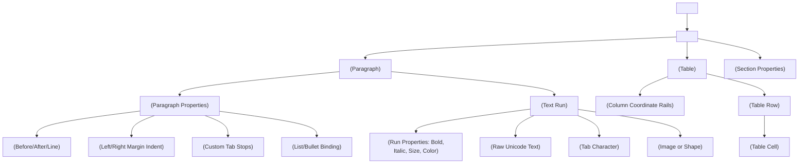

# 📄 DOCX (Office Open XML / ISO/IEC 29500) Internals & Mathematical Specifications

Dokumen ini merupakan referensi mendalam mengenai cara kerja internal berkas **Microsoft Word (.docx)** yang diatur dalam standar internasional **ISO/IEC 29500 (ECMA-376)**, termasuk sistem satuan pengukuran non-desimal, arsitektur aliran dinamis (*reflowable layout*), struktur tabel, tabulasi presisi, serta DrawingML.

---

## 1. STRUKTUR FISIK KONTEN: OPEN PACKAGING CONVENTIONS (OPC)

Berkas `.docx` bukan berkas teks tunggal, melainkan **arsip ZIP terkompresi** yang mematuhi spesifikasi **Open Packaging Conventions (OPC / ISO/IEC 29500-2)**.

```text
document.docx (ZIP Container)
├── [Content_Types].xml                  <-- Kamus MIME types seluruh part di dalam ZIP
├── _rels/
│   └── .rels                            <-- Relasi paket utama (menunjuk ke word/document.xml)
├── word/
│   ├── document.xml                     <-- Batang tubuh dokumen utama (teks, tabel, gambar)
│   ├── styles.xml                       <-- Definisi gaya font & paragraf (Normal, Heading 1, dll.)
│   ├── numbering.xml                    <-- Skema penomoran & butir (lists & bullet points)
│   ├── _rels/
│   │   └── document.xml.rels            <-- Peta relasi ID (rId1 -> media, rId2 -> numbering)
│   └── media/
│       ├── image1.png                   <-- Berkas citra biner asli
│       └── image2.jpeg
```

### 1.1 Integritas Relasi (`Relationships`)
Setiap elemen eksternal (gambar, gaya, penomoran) di dalam `word/document.xml` tidak dipanggil langsung dengan nama file, melainkan menggunakan pengenal relasi `r:id`:
```xml
<!-- word/document.xml -->
<a:blip r:embed="rIdImg1"/>

<!-- word/_rels/document.xml.rels -->
<Relationship Id="rIdImg1" 
  Type="http://schemas.openxmlformats.org/officeDocument/2006/relationships/image" 
  Target="media/image1.jpeg"/>
```

---

## 2. SISTEM MATEMATIKA SATUAN DI WORD (NON-FLOATING POINT UNITS)

Berbeda dengan format lain yang menggunakan angka desimal mengambang (*floating point*), WordprocessingML menggunakan **angka integer murni** untuk menghindari kesalahan pembulatan (*rounding errors*) lintas perangkat keras.

Setiap properti memiliki sistem satuannya sendiri yang unik:

### 2.1 Twips (`dxa` / Twentieths of a Point)
* **Penggunaan**: Dimensi halaman, margin, indentasi paragraf, spasi baris, posisi tab stop, dan lebar kolom tabel.
* **Definisi**: $1/20$ dari $1\text{ Typographic Point}$ ($1/1440\text{ inci}$).
* **Rumus Konversi**:
  $$\text{Twips} = \text{Points} \times 20$$
  $$\text{Twips} = \text{Inches} \times 1440$$
  $$\text{Twips} = \text{Centimeters} \times 566.929$$

### 2.2 Half-Points (`hp` / `ST_HpsMeasure`)
* **Penggunaan**: Ukuran font (`<w:sz>` dan `<w:szCs>`).
* **Definisi**: $1/2$ dari $1\text{ Typographic Point}$.
* **Rumus Konversi**:
  $$\text{HalfPoints} = \text{Points} \times 2$$
  *Contoh*: Font ukuran $12\text{ pt}$ ditulis sebagai `<w:sz w:val="24"/>`. Ukuran $10.5\text{ pt}$ ditulis sebagai `<w:sz w:val="21"/>`.

### 2.3 Eighths of a Point (Eighth-Points)
* **Penggunaan**: Ketebalan garis batas tabel dan paragraf (`<w:top w:sz="..."/>`, `<w:bottom w:sz="..."/>`).
* **Definisi**: $1/8$ dari $1\text{ Typographic Point}$.
* **Rumus Konversi**:
  $$\text{EighthPoints} = \text{Points} \times 8$$
  *Contoh*: Garis batas dengan ketebalan $0.5\text{ pt}$ ditulis sebagai `<w:bottom w:sz="4"/>`. Garis $1\text{ pt}$ ditulis `<w:bottom w:sz="8"/>`.

### 2.4 EMUs (English Metric Units)
* **Penggunaan**: Seluruh koordinat DrawingML (dimensi gambar, bentuk vektor, posisi objek mengambang).
* **Definisi**: Satuan virtual integer terkecil yang habis dibagi oleh satuan inci ($914400\text{ per inci}$) dan centimeter ($360000\text{ per cm}$).
* **Rumus Konversi**:
  $$\text{EMUs} = \text{Points} \times 12700$$
  $$\text{EMUs} = \text{Twips} \times 635$$
  $$\text{EMUs} = \text{Centimeters} \times 360000$$

### 2.5 Multiplier Satuan Garis (*Line Spacing Units*)
* **Penggunaan**: Spasi baris paragraf (`<w:spacing w:line="..." w:lineRule="auto"/>`).
* Satuan dasar per satu baris teks tunggal (*Single Spacing*) adalah **`240`**.
  * Spasi 1.0 (Single): `240`
  * Spasi 1.15: $240 \times 1.15 = 276$
  * Spasi 1.5: $240 \times 1.5 = 360$
  * Spasi 2.0 (Double): $240 \times 2.0 = 480$

---

## 3. HIERARKI STRUKTUR DOKUMEN WORDPROCESSINGML

Dokumen Word menganut pohon aliran terstruktur:



---

## 4. REKONSTRUKSI TABEL PRESISI (`<w:tbl>`)

Di Word, tabel dibangun di atas sistem rel koordinat kolom yang ketat:

### 4.1 Master Table Grid (`<w:tblGrid>`)
Sebelum baris dibuat, Word membutuhkan deklarasi rel kisi vertikal utama:
```xml
<w:tblGrid>
  <w:gridCol w:w="2880"/> <!-- Kolom 1: 2880 twips (2 inci) -->
  <w:gridCol w:w="1440"/> <!-- Kolom 2: 1440 twips (1 inci) -->
  <w:gridCol w:w="4320"/> <!-- Kolom 3: 4320 twips (3 inci) -->
</w:tblGrid>
```

### 4.2 Sel Tergabung Horizontal (`<w:gridSpan>` / Colspan)
Jika sebuah sel membentang di atas 2 kolom kisi rel:
```xml
<w:tc>
  <w:tcPr>
    <w:gridSpan w:val="2"/> <!-- Menggabungkan 2 kolom -->
    <w:tcW w:w="4320" w:type="dxa"/> <!-- 2880 + 1440 = 4320 twips -->
  </w:tcPr>
  <w:p><w:r><w:t>Teks Melintasi 2 Kolom</w:t></w:r></w:p>
</w:tc>
```

### 4.3 Sel Tergabung Vertikal (`<w:vMerge>` / Rowspan)
WordprocessingML tidak menggunakan angka `rowspan="3"`, melainkan model status:
1. **Baris Awal**: Menandai awal penggabungan dengan `w:val="restart"`.
2. **Baris Lanjutan**: Sel di baris-baris bawahnya menyertakan `<w:vMerge/>` (tanpa val, atau `continue`).

```xml
<!-- Baris 1: Mulai merge vertikal -->
<w:tr>
  <w:tc>
    <w:tcPr><w:vMerge w:val="restart"/></w:tcPr>
    <w:p><w:r><w:t>Teks Rowspan</w:t></w:r></w:p>
  </w:tc>
  <w:tc><w:p><w:r><w:t>Kanan 1</w:t></w:r></w:p></w:tc>
</w:tr>

<!-- Baris 2: Lanjutan merge vertikal -->
<w:tr>
  <w:tc>
    <w:tcPr><w:vMerge/></w:tcPr> <!-- Mengikuti sel di atasnya -->
    <w:p/> <!-- Konten kosong karena visual digabung dari atas -->
  </w:tc>
  <w:tc><w:p><w:r><w:t>Kanan 2</w:t></w:r></w:p></w:tc>
</w:tr>
```

---

## 5. TABULASI PRESISI ALIH-ALIH SPASI KOSONG (`<w:tabs>`)

Dalam formulir tanpa garis (seperti `"Nama : John"`), menyisipkan karakter spasi berulang (`" "`) akan menghasilkan pergeseran layout yang berantakan karena font bersifat proporsional (huruf 'W' jauh lebih lebar dari 'i').

Solusi tingkat enterprise adalah memetakan titik koordinat horizontal ($X$) ke **Custom Tab Stops**:
```xml
<w:p>
  <w:pPr>
    <w:tabs>
      <!-- Tab rata kiri di posisi X = 180 pt (3600 twips) -->
      <w:tab w:val="left" w:pos="3600"/>
      <!-- Tab rata kanan dengan titik-titik pemandu (dot leader) di X = 500 pt (10000 twips) -->
      <w:tab w:val="right" w:leader="dot" w:pos="10000"/>
    </w:tabs>
  </w:pPr>
  <w:r><w:t>Daftar Isi Bab 1</w:t></w:r>
  <w:r><w:tab/></w:r> <!-- Melompat ke 3600 twips -->
  <w:r><w:t>Pengantar</w:t></w:r>
  <w:r><w:tab/></w:r> <!-- Melompat ke 10000 twips dengan titik pemandu otomatis -->
  <w:r><w:t>Halaman 1</w:t></w:r>
</w:p>
```

---

## 6. GAMBAR DRAWINGML: INLINE VS FLOATING ANCHOR

Word menyediakan dua metode penempatan grafis:

### 6.1 Inline Graphic (`<wp:inline>`)
* Mengalir bersama teks layaknya sebuah karakter huruf biasa.
* Cocok untuk gambar yang berada di antara dua paragraf.
```xml
<w:drawing>
  <wp:inline distT="0" distB="0" distL="0" distR="0">
    <wp:extent cx="1905000" cy="1270000"/> <!-- Ukuran gambar dalam EMU -->
    <wp:docPr id="1" name="Gambar 1"/>
    <a:graphic>
      <a:graphicData uri="http://schemas.openxmlformats.org/drawingml/2006/picture">
        <pic:pic>
          <!-- ... data gambar dan relasi rIdImg1 ... -->
        </pic:pic>
      </a:graphicData>
    </a:graphic>
  </wp:inline>
</w:drawing>
```

### 6.2 Floating Anchored Graphic (`<wp:anchor>`)
* Mengambang di atas atau di belakang teks pada koordinat absolut halaman:
```xml
<wp:anchor behindDoc="true" locked="false" layoutInCell="true">
  <wp:positionH relativeFrom="page">
    <wp:posOffset>914400</wp:posOffset> <!-- 1 inci dari tepi kiri halaman -->
  </wp:positionH>
  <wp:positionV relativeFrom="page">
    <wp:posOffset>1828800</wp:posOffset> <!-- 2 inci dari tepi atas halaman -->
  </wp:positionV>
  <wp:extent cx="3600000" cy="2700000"/>
  <wp:wrapNone/> <!-- Teks mengalir bebas tanpa terhalang gambar (Watermark) -->
</wp:anchor>
```

---

## 7. RANGKUMAN PERSAMAAN KONVERSI MATEMATIS DARI PDF KE DOCX

| Parameter | PDF Input (ISO 32000) | DOCX Output (ISO/IEC 29500) | Rumus Matematika Implementasi di Rust |
| :--- | :--- | :--- | :--- |
| **X Coordinate** | $X_{pdf}$ (Points) | Indentasi / Tab ($Twips$) | $X_{docx} = (X_{pdf} - MarginLeft_{pdf}) \times 20$ |
| **Y Coordinate** | $Y_{pdf}$ (Origin Bawah) | Spasi Paragraf ($Twips$) | $Y_{docx} = (H_{page} - Y_{pdf}) \times 20$ |
| **Font Size** | $Size_{pdf}$ (Points) | `<w:sz w:val="..."/>` | $Val_{sz} = \text{round}(Size_{pdf} \times 2)$ |
| **Image Width** | $Width_{pdf}$ (Points) | `<wp:extent cx="..."/>` | $cx = \text{round}(Width_{pdf} \times 12700)$ |
| **Image Height** | $Height_{pdf}$ (Points) | `<wp:extent cy="..."/>` | $cy = \text{round}(Height_{pdf} \times 12700)$ |
| **Line Border** | $LineWidth_{pdf}$ (Points) | `<w:bottom w:sz="..."/>` | $Val_{border} = \text{round}(LineWidth_{pdf} \times 8)$ |
| **Single Space** | - | `<w:spacing w:line="240"/>` | Konstanta $240$ twips |

