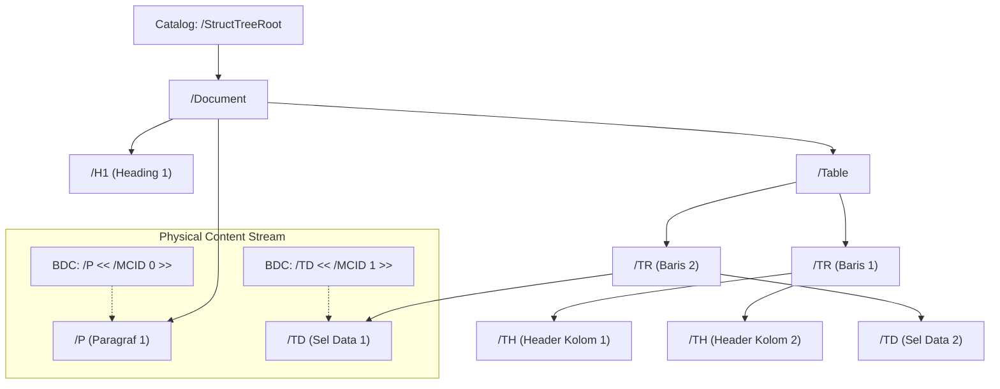

# 🔬 Deep-Dive: Advanced PDF Internals, Edge Cases & Hidden Specifications (ISO 32000-1 / ISO 32000-2)

Dokumen ini melengkapi `docs/PDF_INTERNALS_MATHEMATICS.md` dengan membedah **ranjau teknis tersembunyi (*hidden edge cases*)** dalam spesifikasi ISO 32000 yang sering diabaikan pengembang konverter PDF biasa, namun menjadi faktor penentu apakah mesin konverter kelas enterprise (seperti Adobe Acrobat Pro atau ABBYY) berhasil atau gagal.

---

## 1. STRUKTUR TAGGED PDF & POHON SEMANTIK (`/StructTreeRoot`)

Salah satu rahasia terbesar mengapa Adobe Acrobat Pro bisa mengonversi PDF kompleks dengan akurasi 100% adalah: **Mereka tidak selalu menebak layout dari koordinat fisik!**

Pada PDF modern (dibuat dari Microsoft Word, Adobe InDesign, atau LaTeX yang memenuhi standar ISO 14289 / PDF/UA), PDF tersebut sudah memiliki **Pohon Struktur Logis (*Logical Structure Tree*)**.



### 1.1 Mekanisme Marked Content (`BDC`, `BMC`, `MCID`, `EMC`)
Di dalam aliran konten halaman (*Content Stream*), setiap elemen visual dibungkus dengan penanda semantik:
```postscript
/P << /MCID 0 >> BDC
BT
/F1 12 Tf
72 700 Td
(Ini adalah paragraf semantik asli.) Tj
ET
EMC
```
* `BDC` (*Begin Marked Content Dictionary*) menandai awal blok dengan ID unik `MCID` (*Marked Content Identifier*).
* `EMC` (*End Marked Content*) menutup blok.
* Elemen `/P` di pohon struktur `/StructTreeRoot` merujuk langsung ke halaman tersebut dengan `MCID 0`.

> **Prinsip Rekayasa untuk Rust:**
> Mesin konverter kita harus menerapkan **pendekatan bercabang ganda (*Dual-Path Engine*)**:
> 1. **Jalur Cepat (Authoritative Tagged Path)**: Jika dokumen memiliki `/StructTreeRoot`, gunakan pohon semantik tersebut secara langsung untuk memetakan tag `<H1>`, `<P>`, `<Table>`, `<TR>`, `<TD>` ke OOXML `<w:p>`, `<w:tbl>`, `<w:tr>`, `<w:tc>`. Akurasi 100% tanpa estimasi!
> 2. **Jalur Heuristik (Untagged DLA Fallback)**: Jika dokumen adalah PDF lama atau pindaian tanpa tag, barulah mesin mengaktifkan algoritma Docstrum dan Recursive X-Y Cut.

---

## 2. FORM XOBJECTS (`/XObject /Form`): KONTEN HALAMAN TERSEMBUNYI

Banyak konverter PDF pemula hanya membaca aliran data `/Contents` pada kamus `/Page`. Ini adalah kesalahan fatal.

### 2.1 Apa itu Form XObject?
Dalam ISO 32000-1 §8.10, **Form XObject** adalah sub-halaman mandiri (*self-contained content stream*) yang memiliki:
* Jalur gambar vektor, teks, dan citra sendiri.
* Kamus sumber daya lokal (`/Resources`).
* Matriks transformasi lokal (`/Matrix`).
* Batas pemotongan kanvas lokal (`/BBox`).

### 2.2 Kasus Pemakaian Nyata:
* **Header & Footer Berulang**: Template logo dan kop surat perusahaan di setiap halaman biasanya disimpan sebagai 1 Form XObject yang dipanggil berulang kali menggunakan operator `Do` (`/Fm1 Do`).
* **Watermark & Stempel Transparan**: Dokumen bertuliskan "CONFIDENTIAL" sering diletakkan di dalam Form XObject.
* **Tabel Kompleks & Grafik**: Diagram batang atau grafik sering kali dibungkus di Form XObject.

### 2.3 Rekursi Bersarang (*Nested Form Recursion*)
Form XObject dapat memanggil Form XObject lain di dalamnya (Form A $\to$ Form B $\to$ Teks).
Parser Rust kita harus menggunakan **pola rekursif tumpukan (*stack-based recursive interpreter*)** yang:
1. Menyimpan status grafis saat ini (`q`).
2. Mengalikan matriks saat ini dengan matriks form: $\mathbf{CTM_{new}} = \mathbf{FormMatrix} \times \mathbf{CTM_{parent}}$.
3. Menerapkan pemotongan batas `/BBox`.
4. Mengevaluasi konten di dalam form.
5. Memulihkan status grafis (`Q`).
6. Membatasi kedalaman rekursi maksimal (misal: 16 level) untuk mencegah serangan DoS *cyclic reference*.

---

## 3. DEKOMPRESI EKSTREM: FILTER PREDICTOR PNG PAETH (`/FlateDecode`)

Aliran data biner di PDF dikompresi menggunakan `/FlateDecode` (Zlib/Deflate). Namun, untuk data gambar dan tabel indeks xref, PDF sering menambahkan parameter `/DecodeParms` dengan **Predictor Functions**:

```text
<<
  /Filter /FlateDecode
  /DecodeParms <<
    /Predictor 12          % 12 = PNG Predictor per baris scanline
    /Columns 800           % Lebar baris data
    /Colors 3              % Komponen warna
    /BitsPerComponent 8
  >>
>>
```

Jika parser hanya melakukan inflasi Zlib standar tanpa membalikkan algoritma prediktor, byte hasil dekompresi akan rusak total.

### 3.1 Algoritma Paeth (PNG Filter Type 4)
Setiap awal baris (*scanline*) diawali 1 byte penanda tipe filter (0: None, 1: Sub, 2: Up, 3: Average, 4: Paeth).
Untuk filter Paeth, nilai prediksi $P$ dihitung dari 3 tetangga terdekat:
* $L$ = Byte di sebelah kiri.
* $A$ = Byte di baris atasnya.
* $AL$ = Byte di sudut kiri-atas (diagonal).

$$\text{Estimasi: } p = L + A - AL$$
$$\Delta_L = |p - L|, \quad \Delta_A = |p - A|, \quad \Delta_{AL} = |p - AL|$$

$$\text{Predictor } P = \begin{cases} L & \text{jika } \Delta_L \le \Delta_A \text{ dan } \Delta_L \le \Delta_{AL} \\ A & \text{jika } \Delta_A \le \Delta_{AL} \\ AL & \text{lainnya} \end{cases}$$

Byte asli didekode dengan:
$$\text{OriginalByte} = (\text{RawDecodedByte} + P) \pmod{256}$$

---

## 4. TEXT RENDERING MODE 3: TEKS TAK TERLIHAT (*INVISIBLE OCR TEXT*)

Operator `Tr` menentukan bagaimana teks dirender secara visual:
* `0 Tr`: Fill text (standar).
* `1 Tr`: Stroke text (hanya garis tepi huruf).
* `2 Tr`: Fill + Stroke.
* **`3 Tr`: Neither Fill nor Stroke (Teks 100% Tak Terlihat / Transparan)!**

### Mengapa Mode 3 Sangat Berbahaya Bagi Konverter?
Pada dokumen hasil pemindaian (*scanned PDF*) yang diproses oleh OCR (seperti Adobe Scan, CamScanner, atau Google Lens):
1. Halaman menampilkan **gambar bitmap hasil scan**.
2. Di atas gambar tersebut, OCR menaruh **teks tersembunyi menggunakan mode `3 Tr`** tepat pada posisi koordinat huruf di gambar, agar pengguna bisa memblok (*highlight*), menyalin (*copy-paste*), atau mencari teks (*Ctrl+F*).

**Jika konverter tidak waspada:**
* Konverter akan mengekstrak gambar scan DAN mengekstrak teks mode 3 ke dalam dokumen Word secara bersamaan.
* Hasilnya di Word: Teks muncul menumpuk di atas atau di bawah gambar, membuat dokumen berantakan dan menduplikasi konten!
* **Solusi di Rust:** Deteksi apakah halaman didominasi gambar latar belakang utuh dengan lapisan teks `3 Tr`. Jika ya, buat strategi: render teks sebagai teks Word yang dapat diedit, dan buang gambar latar belakang (atau jadikan watermark di belakang teks).

---

## 5. CLIPPING PATHS (`W` dan `W*`)

PDF memiliki operator batas potong (*clipping path*):
* `W`: Non-zero winding number rule.
* `W*`: Even-odd winding rule.
* Biasanya diikuti oleh operator `n` (*no-op end path*).

Semua teks, gambar, atau garis yang berada di luar poligon *clipping path* **tidak akan terlihat di layar atau kertas cetak**.
Jika sebuah teks diposisikan di koordinat $(100, 500)$, tetapi area potong aktif (*clipping box*) hanya mencakup $X \in [200, 400]$, maka teks tersebut sebenarnya tidak ada secara visual!
Parser tingkat lanjut harus menguji apakah kotak pembatas glif beririsan dengan *clipping path* aktif sebelum memasukkannya ke tata letak Word.

---

## 6. FORMULIR INTERAKTIF & ANOTASI (`/AcroForm` dan `/Annots`)

Pada dokumen formulir resmi (seperti formulir pajak pemerintah, aplikasi visa, surat perjanjian digital):
Teks isian pengguna (nama, tanggal lahir, tanda tangan digital) **TIDAK TERTULIS di aliran `/Contents` halaman!**

Teks tersebut tersimpan di dalam:
1. Kamus dokumen `/AcroForm` $\to$ `/Fields`.
2. Array `/Annots` pada objek `/Page`.
3. Teks nilai tersimpan pada kunci `/V` (*Value*) atau di dalam *Appearance Stream* `/AP` $\to$ `/N`.

Jika mesin parser hanya membaca teks dari `/Contents`, seluruh isian formulir pada dokumen interaktif akan hilang dan hanya meninggalkan halaman kosong!

---

## 7. RANGKUMAN TUNTUTAN ARSITEKTUR MESIN PURE RUST

Berdasarkan seluruh temuan matematis dan teknis ini, mesin Rust yang akan kita bangun harus memiliki kapabilitas berikut:

| Modul Teknis | Spesifikasi yang Wajib Diterapkan |
| :--- | :--- |
| **Parser Biner** | Menangani tabel `/XRef` klasik dan `/XRef` Stream (PDF 1.5+), dekompresi FlateDecode lengkap dengan PNG Predictor (Sub, Up, Average, Paeth). |
| **Font Interpreter** | Membaca kamus font Type 1, TrueType, dan Type 0 (CIDFont), memetakan `/ToUnicode` CMap ke UTF-8, serta membaca `/Differences` array. |
| **Form Evaluator** | Penelusuran rekursif terhadap Form XObjects (`Do`) dengan pewarisan matriks afin $\mathbf{CTM}$. |
| **Tagged-Aware** | Memeriksa `/StructTreeRoot` terlebih dahulu; jika ada, langsung buat dokumen Word terstruktur semantik tanpa heuristik. |
| **State Sanitizer** | Memeriksa Clipping Path (`W`) dan Text Rendering Mode (`Tr`) untuk membuang teks tak terlihat atau teks sampah di luar area cetak. |
| **AcroForm Reader** | Menggabungkan teks isian formulir dari `/Annots` dan `/AcroForm` ke dalam halaman. |

