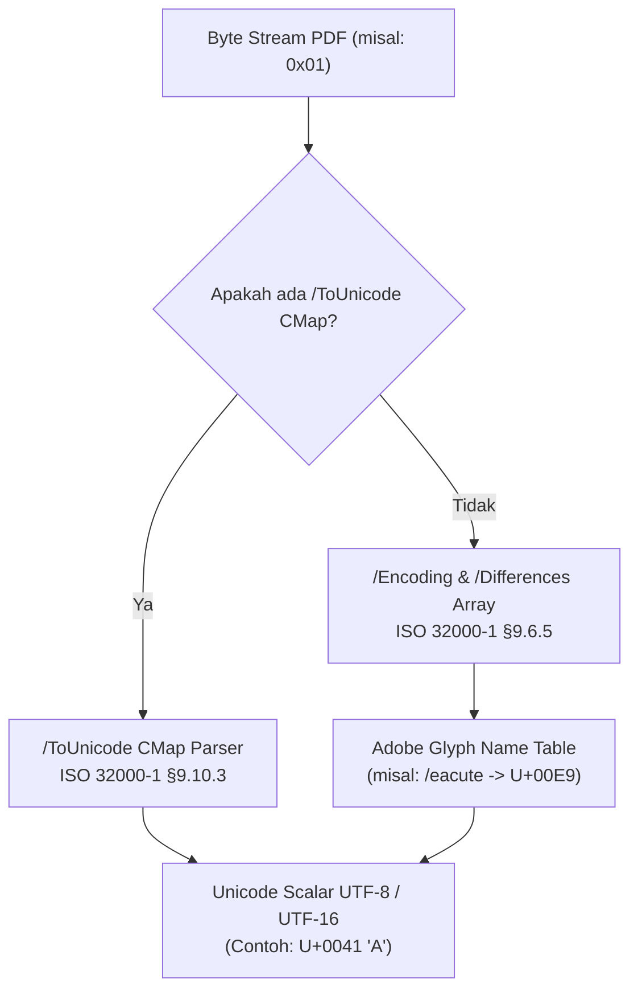

# 📐 Mathematical Foundations and Internal Architecture of PDF (ISO 32000-1 / ISO 32000-2) & Document Layout Analysis (DLA)

Dokumen ini merupakan referensi teoritis, akademis, dan matematis mengenai cara kerja internal berkas **Portable Document Format (PDF)** serta algoritma **Document Layout Analysis (DLA)** yang menjadi fondasi perancangan mesin konverter PDF ke DOCX berkinerja tinggi dalam bahasa **Rust**.

---

## BAGIAN 1: STRUKTUR FISIK & OBJEK INTERNAL PDF (ISO 32000-1)

PDF bukan format berbasis aliran teks semantik seperti HTML atau DOCX. PDF adalah **bahasa program grafik vektor berbasis tumpukan (*stack-based graphics description language*)** yang diturunkan langsung dari Adobe PostScript.

### 1.1 Anatomi Berkas PDF Fisik
Sebuah berkas PDF tersusun atas 4 elemen utama:
1. **Header**: `%PDF-1.7` (Menentukan spesifikasi standar yang digunakan).
2. **Body**: Kumpulan objek tidak langsung (*Indirect Objects*) yang menyimpan teks, font, gambar, metadata, dan vektor halaman.
   ```text
   12 0 obj
   << /Type /Page /Contents 15 0 R /MediaBox [0 0 612 792] >>
   endobj
   ```
3. **Cross-Reference Table (`xref`)**: Peta indeks memori acak (*byte offset*) ke setiap objek dalam berkas:
   ```text
   xref
   0 16
   0000000000 65535 f 
   0000000017 00000 n 
   ```
   Tabel ini memungkinkan pembaca PDF mengakses objek apa pun secara instan ($O(1)$) tanpa harus membaca berkas dari awal.
4. **Trailer**: Menunjuk ke akar katalog dokumen (`/Root`) dan lokasi byte awal tabel xref (`startxref ... %%EOF`).

---

## BAGIAN 2: MATEMATIKA KOORDINAT & TRANSFORMASI MATRIKS AFIN 2D

### 2.1 Ruang Koordinat Kartesius Homogen
Dalam PDF, semua elemen ditempatkan pada bidang koordinat 2D dengan titik asal $(0,0)$ di **sudut kiri-bawah** halaman (*bottom-left origin*), berbanding terbalik dengan format Word (OOXML) dan HTML yang menggunakan titik acuan di **sudut kiri-atas** (*top-left origin*). Satuan dasar pengukuran adalah **Typographic Point** ($1\text{ pt} = 1/72\text{ inci}$).

Untuk menggabungkan rotasi, penskalaan, kemiringan (*shear/skew*), dan pergeseran (*translation*) dalam satu operasi perkalian matriks linear tunggal, PDF menggunakan **Koordinat Homogen 3D Proyektif**:
Sebuah titik fisik $(x, y)$ direpresentasikan sebagai vektor baris $\begin{bmatrix} x & y & 1 \end{bmatrix}$.

Transformasi matriks didefinisikan sebagai matriks afin $3 \times 3$:
$$\mathbf{M} = \begin{bmatrix} a & b & 0 \\ c & d & 0 \\ e & f & 1 \end{bmatrix}$$

Dalam spesifikasi ISO 32000-1, matriks ini disederhanakan dan dituliskan sebagai array 6 elemen: $\begin{bmatrix} a & b & c & d & e & f \end{bmatrix}$.

Transformasi titik $(x, y)$ ke koordinat hasil transformasi $(x', y')$ dihitung sebagai:
$$\begin{bmatrix} x' & y' & 1 \end{bmatrix} = \begin{bmatrix} x & y & 1 \end{bmatrix} \times \begin{bmatrix} a & b & 0 \\ c & d & 0 \\ e & f & 1 \end{bmatrix}$$

Menghasilkan persamaan linear:
$$x' = a \cdot x + c \cdot y + e$$
$$y' = b \cdot x + d \cdot y + f$$

* $a, d$: Penskalaan horizontal dan vertikal ($S_x, S_y$).
* $b, c$: Komponen rotasi dan kemiringan (*shear/skew*). Jika terjadi rotasi murni sebesar sudut $\theta$:
  $$a = \cos\theta, \quad b = \sin\theta, \quad c = -\sin\theta, \quad d = \cos\theta$$
* $e, f$: Pergeseran translasi absolut ($\Delta x, \Delta y$).

---

### 2.2 Hirarki Matriks dan State Machine Teks
PDF memelihara serangkaian matriks untuk merender teks dari *Glyph Space* ke *Device Canvas Space*:

$$\mathbf{T_{rm}} = \mathbf{T_{style}} \times \mathbf{T_m} \times \mathbf{CTM}$$

Di mana:
1. **$\mathbf{CTM}$ (*Current Transformation Matrix*)**: Mengatur orientasi dan transformasi kanvas halaman (diubah via operator `cm`).
2. **$\mathbf{T_m}$ (*Text Matrix*)**: Matriks posisi teks aktif yang diatur oleh operator `Tm` ($a\ b\ c\ d\ e\ f\ \text{Tm}$).
3. **$\mathbf{T_{lm}}$ (*Text Line Matrix*)**: Matriks awal baris teks aktif (disinkronkan dengan `Tm`).
4. **$\mathbf{T_{style}}$**: Matriks lokal ukuran font ($T_{fs}$), skala horizontal ($T_z$), dan *text rise* ($T_{rise}$):
   $$\mathbf{T_{style}} = \begin{bmatrix} T_{fs} \cdot \frac{T_z}{100} & 0 & 0 \\ 0 & T_{fs} & 0 \\ 0 & T_{rise} & 1 \end{bmatrix}$$

#### Operator Perpindahan Garis (`Td` dan `TD`)
Operator `tx ty Td` melakukan translasi relatif terhadap matriks awal baris sebelumnya ($T_{lm\_prev}$):
$$\mathbf{T_{lm}} = \begin{bmatrix} 1 & 0 & 0 \\ 0 & 1 & 0 \\ tx & ty & 1 \end{bmatrix} \times \mathbf{T_{lm\_prev}}$$
$$\mathbf{T_m} \leftarrow \mathbf{T_{lm}}$$

#### Operator Penulisan String dan Kerning (`Tj` dan `TJ`)
Ketika teks dicetak dengan operator `TJ`, parameter yang diberikan adalah array campuran antara teks dan angka offset pergeseran kerning:
```text
[(W) 120 (A) -80 (V) 50 (E)] TJ
```
Angka offset negatif berarti karakter digeser mendekat (kerning rapat), sedangkan angka positif berarti karakter direnggangkan.
Untuk setiap glif dengan lebar metrik $w_0$ dan penyesuaian kerning $t_j$, perpindahan horizontal $\Delta x$ dalam unit teks lokal adalah:
$$\Delta x = \left( \frac{w_0 - \frac{t_j}{1000}}{1000} \cdot T_{fs} + T_c + T_w \right) \cdot \frac{T_z}{100}$$
Di mana $T_c$ adalah *character spacing* dan $T_w$ adalah *word spacing*.

Matriks teks $\mathbf{T_m}$ diperbarui secara otomatis setelah glif dicetak:
$$\mathbf{T_{m\_new}} = \begin{bmatrix} 1 & 0 & 0 \\ 0 & 1 & 0 \\ \Delta x & 0 & 1 \end{bmatrix} \times \mathbf{T_{m\_old}}$$

---

## BAGIAN 3: ENCODING FONT & DEKODE GLIF KE UNICODE (ISO 32000-1 §9.6 - §9.10)

Salah satu alasan konverter PDF amatir menghasilkan teks acak ("alien text") adalah kegagalan memahami perbedaan antara **Font Glyph Index** dan **Unicode Character Code**.



### 3.1 Masalah Font Subsetting
Aplikasi pembuat PDF (seperti InDesign atau Word) biasanya tidak menanamkan seluruh berkas font TrueType (yang berukuran 5–20 MB). Mereka melakukan *subsetting*, hanya menyimpan huruf yang digunakan, lalu mengubah ID glif secara acak (misal: huruf 'P' diberi ID `0x0001`, huruf 'D' diberi ID `0x0002`).

### 3.2 Solusi Standar: `/ToUnicode` CMap
Untuk mengekstrak teks dengan presisi 100%, mesin parser wajib membaca objek `/ToUnicode` CMap (PostScript Stream).
Contoh pemetaan CMap:
```postscript
1 beginbfrange
<0001> <0002> [<0050> <0044>] % 0x0001 -> 'P' (U+0050), 0x0002 -> 'D' (U+0044)
endbfrange
```
Jika font memiliki ligatur (seperti `fi`, `fl`, `ffi`), CMap memetakan satu kode glif ke deretan beberapa karakter Unicode sekaligus:
```postscript
<005F> [<00660066>] % 'ff' (U+0066 + U+0066)
```

---

## BAGIAN 4: JURNAL ILMIAH & LANDASAN TEORITIS DOCUMENT LAYOUT ANALYSIS (DLA)

Setelah seluruh glif berhasil diekstrak bersama koordinat pembatasnya ($x_{min}, y_{min}, x_{max}, y_{max}$), mesin harus merekonstruksi tata letak dokumen menggunakan metodologi akademik berikut:

### 4.1 Algoritma Docstrum (Lawrence O'Gorman, 1993 - IEEE PAMI)
* **Judul**: *The Document Spectrum for Page Layout Analysis*
* **Sitasi**: IEEE Transactions on Pattern Analysis and Machine Intelligence, Vol. 15, No. 11, pp. 1162–1173.
* **Prinsip**: Pendekatan *Bottom-Up*. Untuk setiap komponen terhubung (glif), algoritma mencari $k$-tetangga terdekat ($k$-NN, umumnya $k=5$) dan menghitung vektor jarak Euclidean $d$ serta sudut orientasi $\theta$:
  $$d_i = \sqrt{(x_j - x_i)^2 + (y_j - y_i)^2}$$
  $$\theta_i = \arctan2(y_j - y_i, x_j - x_i)$$
* **Hasil Matematis**: Histogram jarak menghasilkan 3 puncak distribusi (*peaks*):
  1. **$D_{char}$**: Jarak spasi rata-rata antar-karakter dalam satu kata.
  2. **$D_{word}$**: Jarak spasi rata-rata antar-kata dalam satu baris.
  3. **$D_{line}$**: Jarak spasi vertikal antar-baris (leading).
  Nilai-nilai ini menjadi ambang batas dinamis (*adaptive thresholds*) untuk mengelompokkan karakter ke kata dan kata ke baris.

---

### 4.2 Algoritma Recursive X-Y Cut (Ha, Haralick, Phillips, 1995 - ICDAR)
* **Judul**: *Recursive X-Y Cut using Bounding Boxes of Connected Components*
* **Sitasi**: Proc. 3rd International Conference on Document Analysis and Recognition (ICDAR '95), Vol. 2, pp. 952–955.
* **Prinsip**: Pendekatan *Top-Down*. Halaman direpresentasikan sebagai kumpulan bounding box $B = \{b_1, \dots, b_n\}$. Algoritma menghitung fungsi proyeksi kerapatan 1D:
  * Proyeksi Horizontal:
    $$P_H(y) = \sum_{i=1}^{n} \mathbb{I}(y_{min, i} \le y \le y_{max, i})$$
  * Proyeksi Vertikal:
    $$P_V(x) = \sum_{i=1}^{n} \mathbb{I}(x_{min, i} \le x \le x_{max, i})$$
* **Segmentasi Rekursif**: Wilayah yang memiliki celah kosong berkelanjutan ($P_H(y) = 0$ atau $P_V(x) = 0$) yang lebarnya melampaui ambang batas $T_x$ atau $T_y$ dipotong menjadi anak-simpul. Hasil akhirnya adalah **X-Y Spatial Tree** yang merefleksikan struktur kolom dan hierarki baca dokumen secara alami.

---

### 4.3 Algoritma Ekstraksi Tabel & Graph Planar (Anssi Nurminen, 2013)
* **Judul**: *Algorithmic Extraction of Data in Tables in PDF Documents*
* **Institusi**: Tampere University of Technology.
* **Prinsip**:
  1. **Intersection Planar Graph**: Semua garis vektor horizontal $H = \{h_1, \dots, h_m\}$ dan vertikal $V = \{v_1, \dots, v_k\}$ dideteksi titik persimpangannya:
     $$P_{ij} = h_i \cap v_j$$
  2. Dibentuk graf planar $G = (P, E)$. Siklus minimal tertutup (*minimal enclosed cycles / faces*) di dalam graf ini mendefinisikan batas fisik dari sel tabel individu.
  3. **Merged Cells Detection**: Matriks grid referensi $X_{grid}$ dan $Y_{grid}$ disusun dari titik persimpangan unik. Lebar sel yang mencakup lebih dari 1 langkah kisi diidentifikasi sebagai penggabungan kolom (`w:gridSpan`), dan tinggi sel yang mencakup lebih dari 1 baris diidentifikasi sebagai penggabungan baris (`w:vMerge`).

---

## BAGIAN 5: PEMETAAN SATUAN MATEMATIS DARI PDF KE OOXML (WORD)

| Dimensi | Satuan PDF | Satuan OOXML (DOCX) | Rumus Konversi |
| :--- | :--- | :--- | :--- |
| **Posisi / Margin Teks** | Point ($1/72$ in) | Twip ($1/1440$ in) | $\text{Twips} = \text{Points} \times 20$ |
| **Ukuran Huruf (*Font Size*)** | Point | Half-Point | $\text{Val} = \text{Points} \times 2$ |
| **Dimensi Gambar (*Drawing*)** | Point | EMU (*English Metric Unit*) | $\text{EMU} = \text{Points} \times 12700$ |
| **Sumbu Vertikal ($Y$)** | Titik acuan: Kiri-Bawah | Titik acuan: Kiri-Atas | $Y_{word} = (H_{page} - Y_{pdf}) \times 20$ |

---

Dokumen ini menjadi spesifikasi matematis acuan untuk modul `pdf_parser`, `dla`, dan `docx_writer` pada implementasi **Pure Rust**.

